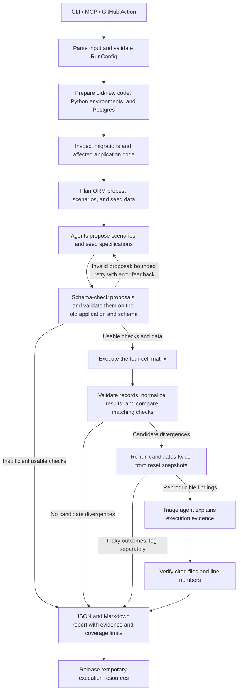
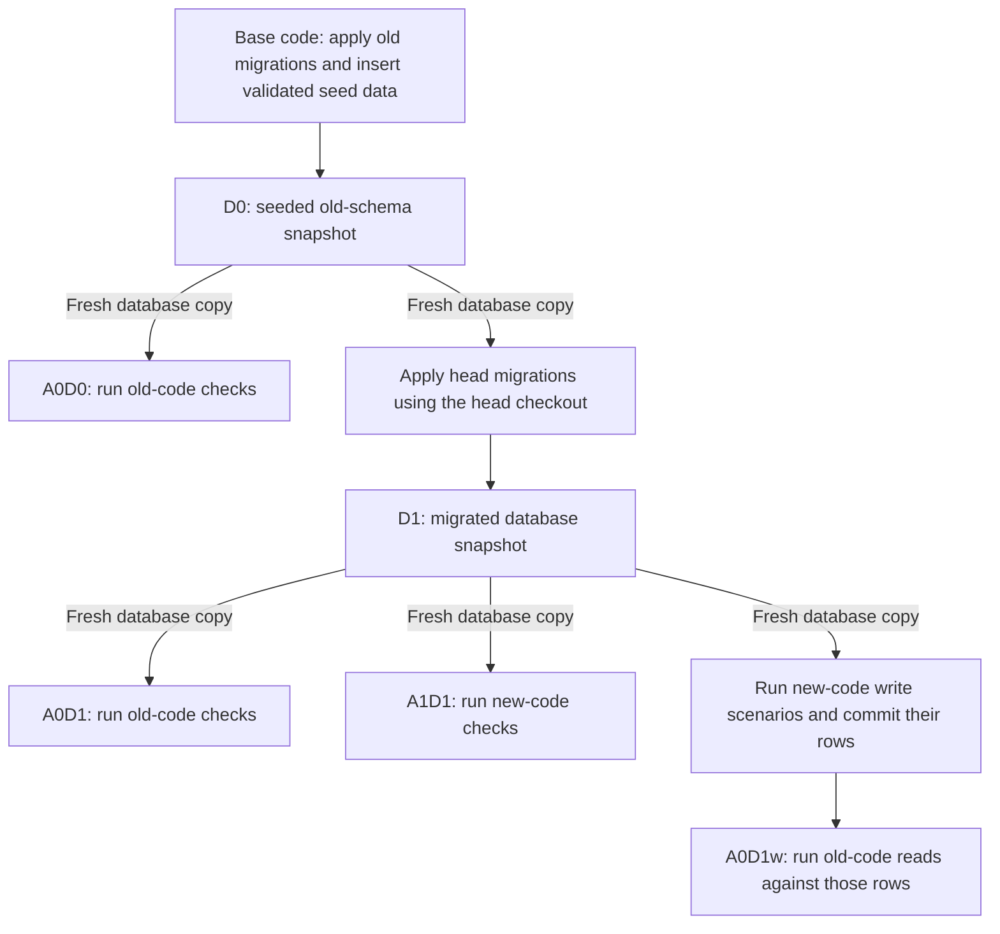

# Proposed SkewGuard architecture

SkewGuard checks Django migration compatibility by executing old and new
application releases against controlled PostgreSQL database states. The MVP
interfaces share one verification workflow.

Configuration validation, execution record types, and temporary Git worktree
management are implemented. The remaining execution and agent components below
are planned.

## Verification workflow

- LangGraph coordinates the workflow, retries, shared state, checkpoints, and
  progress streaming. LangChain agents propose structured scenarios, seed data,
  and explanations.
- Deterministic ORM probes run alongside usable generated scenarios. The first
  executor milestone uses fixture data and deterministic probes before agents
  are introduced.
- Generated seeds must insert successfully into PostgreSQL. Generated scenarios
  must pass baseline validation before contributing to compatibility comparisons.
- Setup failures, migration-application failures, and unusable baselines must be
  reported explicitly. Incomplete execution cannot establish compatibility.
- Cleanup is attempted when contexts exit, including on exceptions; the final
  cleanup node shows the normal completion path.
- Only execution establishes findings. Agent explanations and confidence do not
  replace the observed evidence or the reproduction requirement.

## Database snapshots and matrix execution

The two code checkouts have separate Python environments. A disposable
PostgreSQL container can host the separate test databases. Each cell starts
from a controlled snapshot, and reproduction runs reset to the appropriate
starting state. Within A0D1w, new-code writes remain present for the old-code
reads. A1D1's test writes do not supply A0D1w's starting state.

## Component responsibilities

| Component | Responsibility |
| --- | --- |
| `cli.py`, `mcp_server.py`, `action.yml` | Invoke the same verification workflow from a terminal, coding agent, or pull request. |
| `config.py` | Validate run settings and execution limits. |
| `graph/` | Coordinate stages, retries, checkpointed workflow state, and progress. |
| `agents/` | Generate scenarios and seed specifications; explain verified findings. |
| `static/` | Extract migration operations and SQL, and locate affected code references. |
| `exec/` | Manage checkouts, environments, databases, probes, scenario execution, outcome normalization, and comparison. |
| `report/` | Produce machine-readable JSON and Markdown summaries. |
| `benchmark/` | Evaluate labeled cases against baselines and the single-agent ablation using code-based metrics. |

LangSmith tracing records workflow activity and benchmark experiments. Model
budgets and caching bound generation costs. Checkpointed graph state must be
paired with retained or reconstructed execution resources when resuming a run.

An optional fixer can propose migration changes and submit them to the same
execution workflow. A fix is labeled verified only after the required matrix
checks pass. Fix generation is outside the initial execution foundation.
